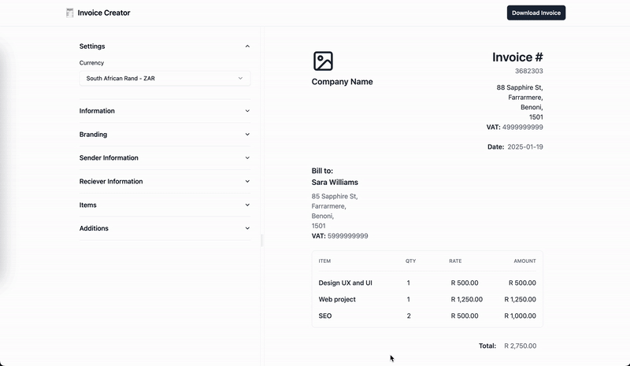

# 🧾 Invoice Creator

A fast, free, and unlimited invoice creation tool. Create professional invoices in minutes with a clean, modern interface.



## ✨ Features

- **Real-time Preview** – See your invoice changes instantly as you type
- **Local Storage** – All data is stored locally on your device for privacy and convenience
- **Auto-fill** – Sender information is automatically populated from your previous invoices
- **PDF Export** – Download or print invoices as high-quality PDFs
- **No Sign-up Required** – Completely free and unlimited use
- **Modern UI** – Built with Vue 3 and Tailwind CSS for a beautiful user experience

## 🚀 Getting Started

### Installation

```bash
# Clone the repository
git clone https://github.com/yourusername/invoice-creator.git
cd invoice-creator

# Install dependencies
pnpm install

# Start development server
pnpm dev
```

### Building for Production

```bash
pnpm build
```

## 💡 How It Works

1. **Fill the Form** – Enter your business details and invoice information on the left panel
2. **See the Preview** – Watch your invoice update in real-time on the right
3. **Download** – Click "Download Invoice" to save as PDF when you're satisfied

Your information is saved automatically to your browser's local storage, so your sender details will be ready for the next invoice.

## 🛠️ Tech Stack

- **Vue 3** – Progressive JavaScript framework
- **Vite** – Next-generation build tool
- **Tailwind CSS** – Utility-first CSS framework
- **Shadcn/vue** – Beautiful UI components

## 📝 License

This project is open source and available under the MIT License.